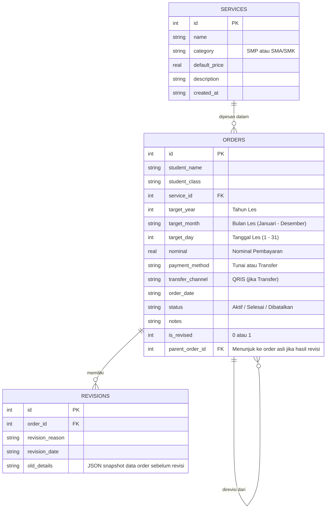
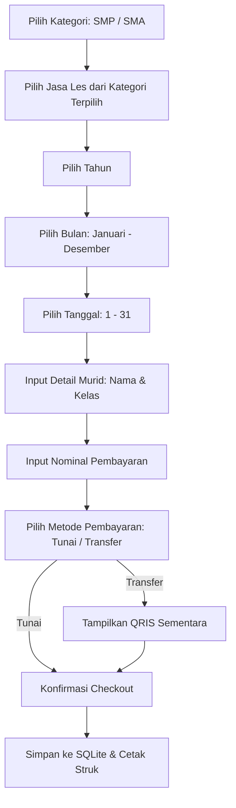

# Dokumen Desain Sistem: Tutorku

Dokumen ini menjelaskan desain arsitektur, database, alur cetak printer, sistem backup, dan mekanisme penghapusan data AppData pada saat uninstal untuk aplikasi **Tutorku** (platform Android, iOS, dan Windows).

---

## 1. Arsitektur Aplikasi & Teknologi

Aplikasi Tutorku akan dikembangkan dengan Flutter menggunakan pola **Clean Architecture** yang disederhanakan (atau **MVVM**), untuk memastikan pemisahan logika bisnis dari UI.

### Stack Teknologi
- **Framework UI**: Flutter (mendukung Android, iOS, dan Windows).
- **State Management**: `Provider` (sederhana, tangguh, dan performa tinggi untuk aplikasi lokal).
- **Database Lokal**: SQLite via `sqflite` (untuk mobile) dan `sqflite_common_ffi` (untuk Windows desktop). Ini memudahkan relasi antar tabel (jasa, order, revisi) serta ekspor-impor data.
- **Bluetooth Printing**: `print_bluetooth_thermal` dan `esc_pos_utils` untuk pembuatan dan pengiriman byte command ESC/POS ke printer thermal bluetooth.
- **Backup & File Picker**: `file_picker` dan `share_plus` untuk menyimpan atau membagikan file backup.
- **Packaging Windows**: **Inno Setup** untuk membuat installer `.exe` Windows yang mendukung kustomisasi uninstaller.

---

## 2. Desain Database Relasional (SQLite)

Karena data disimpan secara offline di perangkat masing-masing, kita menggunakan SQLite untuk kemudahan relasi dan manajemen transaksi.

### Skema Tabel



### Detail Kolom Tabel

#### A. Tabel `services`
| Kolom | Tipe | Keterangan |
| :--- | :--- | :--- |
| `id` | INTEGER (PK, AutoIncrement) | ID unik jasa |
| `name` | TEXT | Nama jasa les (misal: "Les Matematika Kelas 9") |
| `category` | TEXT | Kategori jasa (`SMP` atau `SMA/SMK`) |
| `default_price` | REAL | Harga bawaan jasa les per sesi / bulan |
| `description` | TEXT | Deskripsi singkat mengenai jasa |
| `created_at` | TEXT | Tanggal pembuatan jasa (ISO 8601) |

#### B. Tabel `orders`
| Kolom | Tipe | Keterangan |
| :--- | :--- | :--- |
| `id` | INTEGER (PK, AutoIncrement) | ID unik transaksi |
| `student_name` | TEXT | Nama anak / murid |
| `student_class` | TEXT | Kelas anak (misal: "9 SMP", "12 SMA") |
| `service_id` | INTEGER (FK) | Relasi ke `services.id` |
| `target_year` | INTEGER | Tahun pelaksanaan les yang dipilih |
| `target_month` | TEXT | Bulan pelaksanaan les yang dipilih (Januari - Desember) |
| `target_day` | INTEGER | Tanggal pelaksanaan les yang dipilih (1 - 31) |
| `nominal` | REAL | Nominal pembayaran yang diinput |
| `payment_method`| TEXT | Metode pembayaran (`Tunai` atau `Transfer`) |
| `transfer_channel`| TEXT | Jalur transfer (`QRIS` atau `None`) |
| `order_date` | TEXT | Tanggal pemesanan dibuat |
| `status` | TEXT | Status order (`Aktif`, `Selesai`, `Dibatalkan`) |
| `notes` | TEXT | Catatan tambahan |
| `is_revised` | INTEGER | Flag apakah order ini hasil revisi (`1` = Ya, `0` = Tidak) |
| `parent_order_id`| INTEGER (FK, Nullable) | ID order sebelumnya jika order ini direvisi |

#### C. Tabel `revisions`
Tabel ini digunakan untuk mencatat riwayat perubahan atau revisi order secara detail.
| Kolom | Tipe | Keterangan |
| :--- | :--- | :--- |
| `id` | INTEGER (PK, AutoIncrement) | ID unik revisi |
| `order_id` | INTEGER (FK) | Relasi ke `orders.id` (order saat ini) |
| `revision_reason` | TEXT | Alasan revisi dilakukan |
| `revision_date` | TEXT | Tanggal revisi dilakukan |
| `old_details` | TEXT | Snapshot data lama dalam format JSON (menyimpan nominal, tanggal, dll sebelum diubah) |

---

## 3. Alur Pemesanan Baru (Checkout Flow)

Ketika pengguna menekan tombol "Pesan Jasa Les Baru", alur antarmuka yang akan dijalankan adalah sebagai berikut:



---

## 4. Integrasi Printer Bluetooth (Universal)

Printer thermal mini bluetooth menggunakan protokol standar **ESC/POS**. Implementasinya adalah sebagai berikut:

1. **Pemindaian & Koneksi**:
   - Flutter memindai perangkat Bluetooth sekitar menggunakan library `print_bluetooth_thermal`.
   - Pengguna memilih printer yang sesuai dari daftar di aplikasi.
   - Aplikasi menyimpan alamat MAC printer terpilih di `SharedPreferences` agar bisa otomatis terhubung di sesi berikutnya.
2. **Pembuatan Layout Struk (ESC/POS)**:
   - Menggunakan `esc_pos_utils` untuk merancang struk dalam bentuk byte biner.
   - Layout struk akan berukuran lebar **58mm** (standar printer thermal portabel) atau **80mm** (fleksibel secara konfigurasi).
   - Isi struk mencakup:
     - Header (Nama Bimbingan/Les, Alamat/Kontak)
     - Separator (`--------------------------------`)
     - Informasi Order (Nomor Struk, Tanggal, Nama Murid, Kelas)
     - Detail Jasa (Nama Jasa, Kategori, Harga)
     - Total Bayar
     - Catatan Revisi (Jika order ini hasil revisi)
     - Footer ("Terima kasih telah mempercayai kami!")

---

## 4. Sistem Backup & Restore Data

Karena aplikasi bersifat **full offline**, pengguna bertanggung jawab penuh atas keamanan datanya. Fitur backup/restore dirancang sebagai berikut:

### Backup (Ekspor)
1. Aplikasi membaca seluruh isi database SQLite atau langsung menyalin file database `tutorku.db`.
2. File database dikompresi atau langsung diekspor sebagai file dengan ekstensi `.tkubak` (TutorKu Backup) atau `.db`.
3. **Di Android/iOS**: Membuka dialog sistem "Share File" agar pengguna dapat mengirim file backup ke Google Drive, Email, WhatsApp, atau menyimpannya di folder dokumen eksternal.
4. **Di Windows**: Membuka dialog "Save File" sehingga pengguna dapat menentukan folder penyimpanan secara bebas di komputer mereka.

### Restore (Impor)
1. Pengguna membuka menu Restore dan menekan tombol "Pilih File Backup".
2. Dialog pencari file terbuka (`file_picker`), menyaring file berekstensi `.tkubak` atau `.db`.
3. Aplikasi melakukan verifikasi integritas file database (memastikan tabel-tabel utama valid).
4. Aplikasi menggantikan file database aktif dengan file backup tersebut (melakukan overwrite).
5. Aplikasi me-restart state atau menampilkan notifikasi bahwa data berhasil dipulihkan.

---

## 5. Solusi Khusus Windows: Penghapusan Data Saat Uninstall

Masalah umum pada Windows adalah uninstall aplikasi standar tidak menghapus folder AppData (di mana database disimpan). Ini menyisakan sampah data di komputer pengguna.

### Solusi: Inno Setup Uninstaller Custom Action
Kita akan menggunakan **Inno Setup** untuk membungkus file executable Flutter Windows. Dalam file konfigurasi script `.iss` (Inno Setup Script), kita akan menyisipkan kode Pascal untuk menampilkan peringatan dan pilihan penghapusan folder AppData saat aplikasi di-uninstal.

#### Contoh Implementasi Script Inno Setup (`installer_script.iss`):
```pascal
[Setup]
AppName=TutorKu
AppVersion=1.0.0
DefaultDirName={autopf}\TutorKu
DefaultGroupName=TutorKu
OutputDir=output
OutputBaseFilename=TutorKuSetup

[Files]
Source: "build\windows\runner\Release\*"; DestDir: "{app}"; Flags: recursesubdirs createallsubdirs

[Code]
procedure CurUninstallStepChanged(CurUninstallStep: TUninstallStep);
var
  Response: Integer;
  AppDataPath: String;
begin
  // CurUninstallStep = usPostUninstall dipanggil setelah file program utama berhasil dihapus
  if CurUninstallStep = usPostUninstall then
  begin
    // Menampilkan kotak dialog konfirmasi kepada pengguna dengan peringatan keras
    Response := MsgBox(
      'Apakah Anda ingin menghapus seluruh data transaksi, riwayat order, dan pengaturan TutorKu dari komputer Anda?' #13#10 #13#10 +
      'PERINGATAN: Semua data lokal akan hilang secara permanen jika Anda tidak memiliki file backup.', 
      mbConfirmation, 
      MB_YESNO or MB_DEFBUTTON2
    );
    
    if Response = IDYES then
    begin
      // Mendapatkan path folder AppData Roaming milik aplikasi
      // Mengikuti format default path_provider: AppData\Roaming\<CompanyName>\<AppName>
      // Ganti 'com.example' dan 'tutorku' sesuai konfigurasi Runner.rc
      AppDataPath := ExpandConstant('{userappdata}\com.example\tutorku');
      
      // Menghapus folder beserta seluruh isinya secara rekursif
      if DirExists(AppDataPath) then
      begin
        if DelTree(AppDataPath, True, True, True) then
          Log('Folder AppData TutorKu berhasil dihapus.')
        else
          Log('Gagal menghapus folder AppData TutorKu.');
      end;
    end;
  end;
end;
```

*Dengan mekanisme ini, ketika pengguna meng-uninstal aplikasi TutorKu di Windows, mereka akan mendapatkan dialog peringatan interaktif yang menanyakan apakah ingin menghapus data transaksinya atau membiarkannya tetap ada.*

---

## 6. Desain Antarmuka (Aesthetics & UX)

Desain aplikasi akan dibuat dengan tema **Modern Indigo Premium**:
1. **Dashboard**:
   - Menggunakan kombinasi warna gelap (Dark Mode) atau warna terang yang modern dengan kontras tinggi (Indigo & Slate).
   - Menampilkan kartu ringkasan: **Total Jasa Aktif**, **Total Order Masuk**, **Total Pendapatan**.
   - CTA Utama: Tombol besar dengan gradasi warna `Indigo to Violet` yang berkilau (glow effect) untuk **"Buat Pesanan Baru"** (Pesan Jasa Les).
2. **Form Pemesanan & Revisi**:
   - Form input yang ramah pengguna dengan dropdown pilihan kategori jasa, input nama anak, dan catatan.
   - Pilihan "Revisi" akan memuat data lama dan mengizinkan pengubahan dengan kolom wajib mengisi "Alasan Revisi".
3. **Halaman Riwayat**:
   - Filter pencarian cepat untuk membedakan order SMP dan SMA/SMK.
   - Tombol cetak struk yang menampilkan status printer (Tersambung / Terputus) secara real-time.
